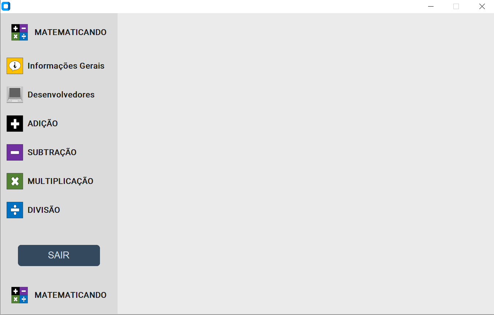
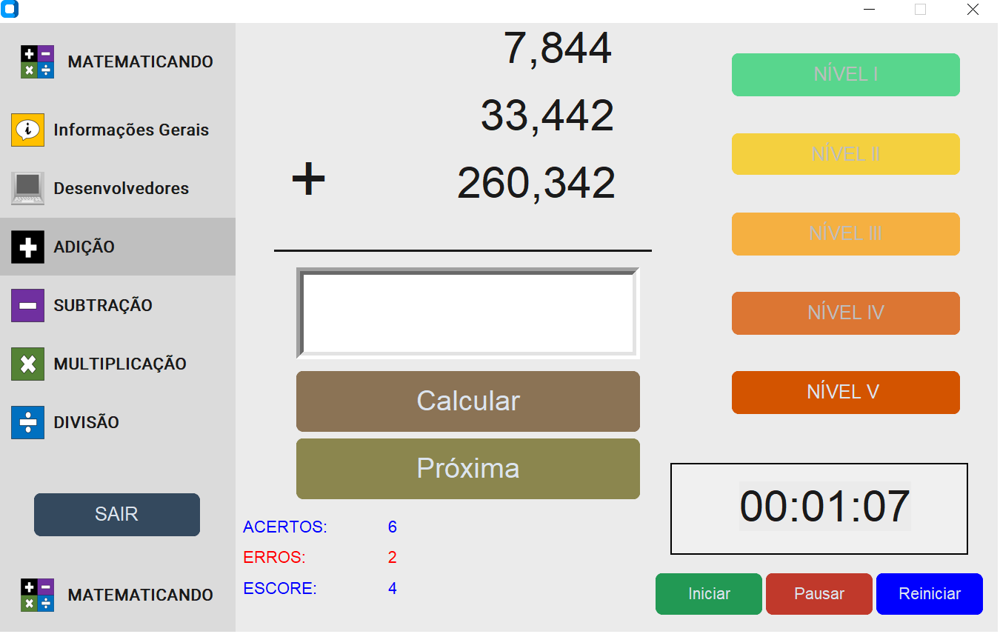

# 🧮 Matematicando – Aplicativo Educacional

  <strong>Aprender matemática pode ser mais simples, interativo e divertido!</strong>

  

## 📚 Sobre o projeto

O **Matematicando** é um aplicativo educacional desenvolvido em **Python**, com interface gráfica construída por meio das bibliotecas **Tkinter** e **CustomTkinter**.

Esta é a sua primeira versão, concebida como uma ferramenta educacional complementar, destinada a estimular o aprendizado, a prática e o desenvolvimento do raciocínio matemático por meio das quatro operações fundamentais:

- ➕ **Adição**
- ➖ **Subtração**
- ✖️ **Multiplicação**
- ➗ **Divisão**

Com uma interface intuitiva e acessível, o aplicativo foi projetado para atender usuários de diferentes idades e níveis de conhecimento, oferecendo atividades com diversos graus de dificuldade.

## 🎯 Objetivo educacional

O **Matematicando** foi desenvolvido no âmbito de um **projeto de pesquisa e inovação tecnológica**, com foco na criação de recursos educacionais digitais que integrem conhecimentos de programação e práticas de ensino-aprendizagem da matemática.

A proposta é proporcionar um ambiente de aprendizagem complementar, estimulando:

- O desenvolvimento do raciocínio lógico-matemático;
- A compreensão das operações fundamentais;
- A autonomia na resolução de problemas;
- A prática matemática por meio de recursos digitais.

## 📖 Alinhamento com a BNCC

O aplicativo busca contribuir para o desenvolvimento de habilidades matemáticas previstas na **Base Nacional Comum Curricular (BNCC)** para o Ensino Fundamental, especialmente aquelas relacionadas às seguintes habilidades:

| Código | Área de aprendizagem |
|:---:|---|
| EF03MA06 | Adição e subtração |
| EF03MA07 | Multiplicação |
| EF03MA08 | Divisão |

## 💻 Tecnologias utilizadas

O desenvolvimento do **Matematicando** utiliza as seguintes tecnologias:

- 🐍 **Python** – linguagem de programação;
- 🖥️ **Tkinter** – construção da interface gráfica;
- 🎨 **CustomTkinter** – personalização e modernização dos componentes visuais.

## 🖼️ Interface do aplicativo

Confira algumas telas do Matematicando:

  
   
  <em>Figura 1 – Interface do aplicativo.</em>

  
   
  <em>Figura 2 – Funcionalidades do aplicativo na aba "somar".</em>

## 🖥️ Disponibilidade

O Matematicando está disponível para sistemas operacionais **Windows**.

## 🏆 Registro de programa de computador

O software possui registro junto ao Instituto Nacional da Propriedade Industrial (INPI):

**Registro nº BR512024002216-3.**

## 📩 Contato

Para dúvidas, sugestões, informações ou contribuições relacionadas ao projeto, entre em contato:

**Jailson França dos Santos**

📧 [jailson.santos@ufob.edu.br](mailto:jailson.santos@ufob.edu.br)

---

  <strong>Matematicando – Tecnologia e educação a serviço da aprendizagem matemática!</strong>

